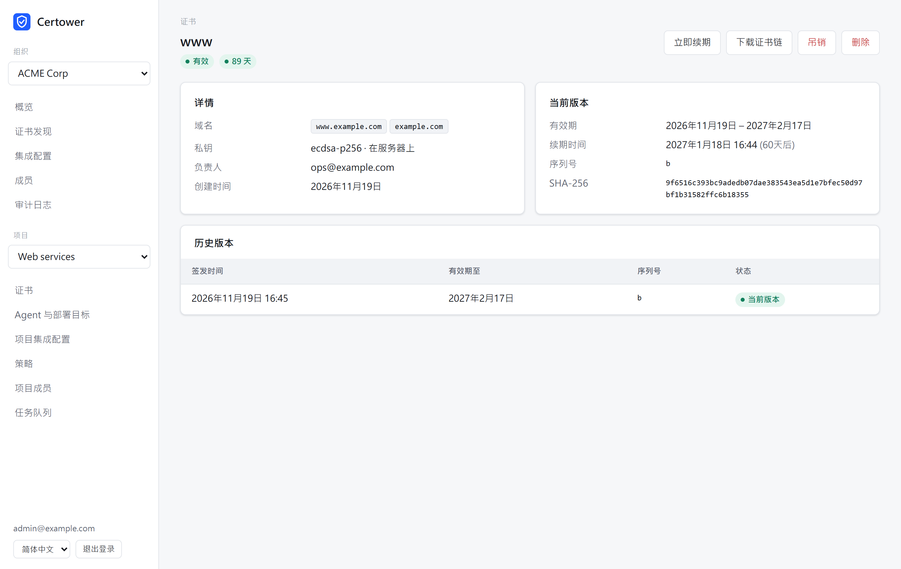

# Certower

[](https://github.com/tntrock/certower/actions/workflows/ci.yml)
[](https://github.com/tntrock/certower/security/code-scanning)
[](https://scorecard.dev/viewer/?uri=github.com/tntrock/certower)
[](https://goreportcard.com/report/github.com/tntrock/certower)
[](LICENSE)


**可自托管的 TLS 证书管控中心。** 发现您在用的每一张证书，通过 ACME 向任意 CA
签发和续期，并自动部署到服务器和网络设备，同时提供多租户权限管理。

[English](README.md) | [繁體中文](README.zh-TW.md) | 简体中文



> 状态：早期开发阶段，暂不建议用于生产环境。

## 为什么需要它

公网 TLS 证书的有效期正在不断缩短：2026 年 3 月起为 200 天，2027 年 3 月起为
100 天，2029 年 3 月起仅剩 47 天。靠人工更换证书已经跟不上这个节奏。Certower
把证书的整个生命周期自动化，暂时无法自动化的环节也会明确列出来。

## 功能

- **证书发现**：扫描端点，找出未纳管的证书，并标出即将过期、密钥强度不足、
  有效期超出上限，以及已不被浏览器信任的根证书（例如台湾中华电信在 2025 年
  7 月 31 日之后签发的证书）。
- **兼容任意 ACME CA**：Let's Encrypt、ZeroSSL、Google Trust Services、
  Sectigo、GlobalSign、DigiCert、TWCA 等，支持外部账号绑定（EAB）。DNS-01
  验证支持 150 多家 DNS 服务商。
- **私钥不出主机的 Agent**：私钥在目标主机上生成，从不外传；每次部署后都会
  检查线上端点，失败自动回滚。
- **组织、项目与角色**：可按域名、CA、密钥类型设置策略约束，支持 OIDC
  单点登录和审计日志。
- **通知**：邮件和 Webhook（Slack、Mattermost、Google Chat、Discord，或带签名的
  JSON），覆盖到期提醒、签发／部署失败和证书发现告警。
- **插件化**：签发方（Issuer）、DNS、部署方式（Deployer）和通知（Notifier）均可扩展。
- **Web 管理界面**：支持简体中文、繁體中文和 English。

## 快速开始

**容器：**

```sh
docker run -d --name certower -p 8080:8080 -p 8443:8443 -v certower-data:/data ghcr.io/tntrock/certower:latest
docker exec certower certower bootstrap -email you@example.com   # 会输出自动生成的密码
```

打开 http://localhost:8080 登录即可。

**其他安装方式**，请从 [Releases 页面](https://github.com/tntrock/certower/releases)下载：

| 平台 | 安装包 |
|---|---|
| Windows | `.msi` 安装程序，以 Windows 服务运行 |
| Debian、Ubuntu | `.deb`，附带 systemd 服务 |
| RHEL、Rocky、Fedora、openEuler | `.rpm`，附带 systemd 服务 |
| 其他 | `.tar.gz`／`.zip` 可执行文件；Docker Compose 示例位于 [`deploy/`](deploy) |

然后请参阅[管理员手册](docs/zh-CN/admin-guide.md)（HTTPS、备份、密钥加密密钥）和[用户手册](docs/zh-CN/user-guide.md#快速开始)（申请第一张证书）。

**从源码构建**（Go 1.26+、Node.js 22+）：

```sh
(cd web && npm ci && npm run build)   # Web 界面会打包进可执行文件
go build -o bin/ ./cmd/...
./bin/certower bootstrap -email admin@example.com
./bin/certower serve
```

界面会根据浏览器语言自动选择，也可以在登录页或侧边栏底部随时切换。

## 文档

用户手册和管理员手册提供中文版，其余文档目前为英文。

- [用户手册](docs/zh-CN/user-guide.md)：申请、续期、部署证书，证书发现与通知
- [管理员手册](docs/zh-CN/admin-guide.md)：安装（容器、Windows、Linux）、配置、HTTPS、备份、升级
- [架构](docs/architecture.md)
- [REST API](docs/api.md)
- [登录与认证](docs/authentication.md)：OIDC 单点登录、登录失败次数限制、反向代理
- [Agent](docs/agent.md)：安装、部署到 nginx、安全模型
- [证书发现与通知](docs/discovery-and-notifications.md)
- [数据模型](docs/data-model.md)
- [CA 支持情况](docs/ca-support.md)
- [签发测试](docs/testing-issuance.md)：Pebble 自动化测试，以及通过 Cloudflare DNS 实测 Let's Encrypt

## 安全

如发现安全漏洞，请通过私密渠道报告，不要提交公开 issue，详见 [SECURITY.md](SECURITY.md)。

## 许可证

[GNU Affero General Public License v3.0](LICENSE)。
