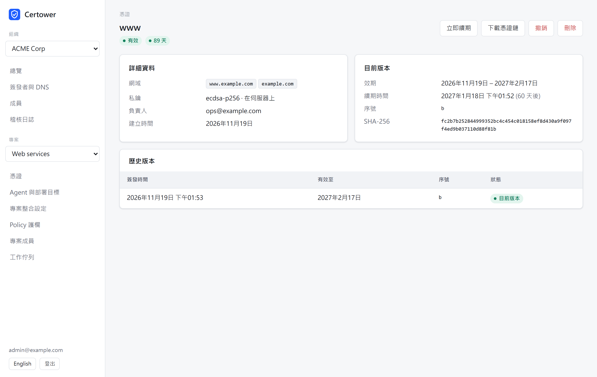

# Certower

[](https://github.com/tntrock/certower/actions/workflows/ci.yml)
[](https://github.com/tntrock/certower/security/code-scanning)
[](https://scorecard.dev/viewer/?uri=github.com/tntrock/certower)
[](https://goreportcard.com/report/github.com/tntrock/certower)
[](LICENSE)


**自架的 TLS 憑證中控塔台。** 找出你所有正在使用的憑證，透過 ACME 向任何 CA
簽發與續期，並自動部署到伺服器與網路設備，同時提供多租戶權限控管。

[English](README.md) | 繁體中文 | [简体中文](README.zh-CN.md)



> 狀態：早期開發中，尚不適合正式環境使用。

## 為什麼需要

公開 TLS 憑證的效期正在縮短：2026 年 3 月起 200 天、2027 年 3 月起 100 天、
2029 年 3 月起只剩 47 天。人工換憑證跟不上這個速度。Certower 將整個生命週期
自動化，無法自動化的部分也會清楚列出。

## 功能

- **探索**：掃描端點，找出未納管的憑證，並標示即將到期、弱金鑰、效期超過上限，
  以及瀏覽器已不信任的根憑證（例如 2025/7/31 之後簽發的中華電信憑證）。
- **支援任何 ACME CA**：Let's Encrypt、ZeroSSL、Google Trust Services、
  Sectigo、GlobalSign、DigiCert、TWCA 等，支援 EAB。DNS-01 驗證支援 150 多家 DNS 供應商。
- **私鑰不離開主機的 Agent**：私鑰在主機上產生且不會外傳；每次部署都會檢查線上
  端點，失敗自動回滾。
- **組織、專案與角色**：可依網域、CA、金鑰類型設定 Policy 護欄，支援 OIDC
  單一登入與稽核日誌。
- **通知**：Email 與 Webhook（Slack、Mattermost、Google Chat、Discord 或帶簽章的 JSON）：到期提醒、簽發／部署失敗、探索告警。
- **插件**：Issuer、DNS、Deployer、Notifier 皆可擴充。
- **Web 管理介面**：支援繁體中文、簡體中文與英文。

## 快速開始

**容器：**

```sh
docker run -d --name certower -p 8080:8080 -p 8443:8443 -v certower-data:/data ghcr.io/tntrock/certower:latest
docker exec certower certower bootstrap -email you@example.com   # 會印出自動產生的密碼
```

開啟 http://localhost:8080 登入即可。

**其他安裝方式**，請到 [Releases 頁面](https://github.com/tntrock/certower/releases)下載：

| 平台 | 套件 |
|---|---|
| Windows | `.msi` 安裝程式，以 Windows 服務執行 |
| Debian、Ubuntu | `.deb`，附 systemd 服務 |
| RHEL、Rocky、Fedora | `.rpm`，附 systemd 服務 |
| 其他 | `.tar.gz`／`.zip` 執行檔；Docker Compose 範例在 [`deploy/`](deploy) |

接著請看[管理員手冊](docs/zh-TW/admin-guide.md)（HTTPS、備份、金鑰加密金鑰）與[使用者手冊](docs/zh-TW/user-guide.md#快速開始)（申請第一張憑證）。

**從原始碼建置**（Go 1.26+、Node.js 22+）：

```sh
(cd web && npm ci && npm run build)   # Web 介面會打包進執行檔
go build -o bin/ ./cmd/...
./bin/certower bootstrap -email admin@example.com
./bin/certower serve
```

介面會依瀏覽器語言自動選擇，也可以在登入頁或側邊欄底部隨時切換。

## 文件

使用者手冊與管理員手冊有中文版，其餘文件目前為英文。

- [使用者手冊](docs/zh-TW/user-guide.md)：申請、續期、部署憑證，憑證探索與通知
- [管理員手冊](docs/zh-TW/admin-guide.md)：安裝（容器、Windows、Linux）、設定、HTTPS、備份、升級
- [架構](docs/architecture.md)
- [REST API](docs/api.md)
- [登入與驗證](docs/authentication.md)：OIDC 單一登入、登入失敗次數限制、反向代理
- [Agent](docs/agent.md)：安裝、部署到 nginx、安全模型
- [憑證探索與通知](docs/discovery-and-notifications.md)
- [資料模型](docs/data-model.md)
- [CA 支援狀況](docs/ca-support.md)
- [簽發測試](docs/testing-issuance.md)：Pebble 自動化測試，以及用 Cloudflare DNS 實測 Let's Encrypt

## 安全性

發現漏洞請私下回報，不要開公開 issue，詳見 [SECURITY.md](SECURITY.md)。

## 授權

[GNU Affero General Public License v3.0](LICENSE)。
