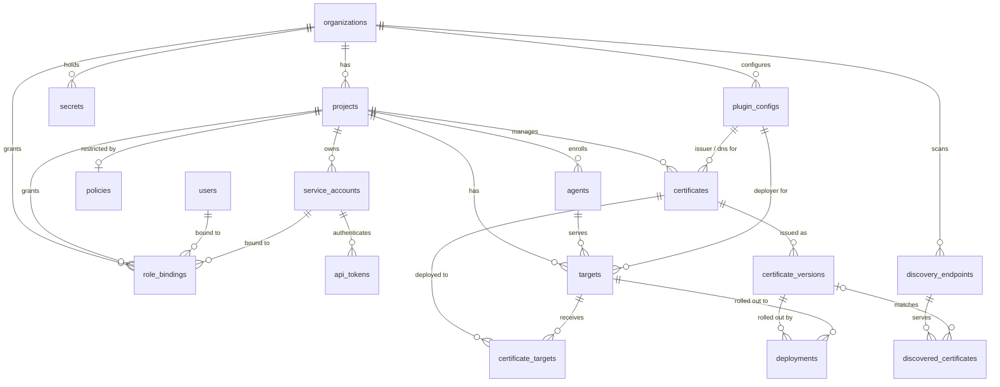

# Data Model

The schema lives in
[`internal/store/migrations/postgres`](../internal/store/migrations/postgres).
The SQLite migrations mirror it, using JSON text in place of arrays and JSONB.

## Key ideas

- **`certificates` holds desired state** (names, key type, issuer, targets).
  Each issuance is one row in **`certificate_versions`**. Renewal creates a new
  version and leaves the old one for history and rollback.
- **`renew_after`** is computed at issuance from ARI, or from
  `renew_before_ratio` when the CA has no ARI. The scheduler only has to query
  `renew_after < now()`.
- **`key_location = 'agent'`** means the private key exists only on the host.
  The server stores the chain, never the key. `key_secret_id` is set only for
  server-side connectors.
- **`plugin_configs`** stores every configured Issuer, DNS provider, Deployer
  and Notifier. A NULL `project_id` makes the config shared across the
  organization, such as one TWCA account used by all projects.
- **`discovered_certificates.version_id`** links what is actually being served
  to what Certower issued. NULL means an unmanaged certificate.
- **`audit_log`** is append-only. Revoke UPDATE and DELETE from the app's
  database role.
