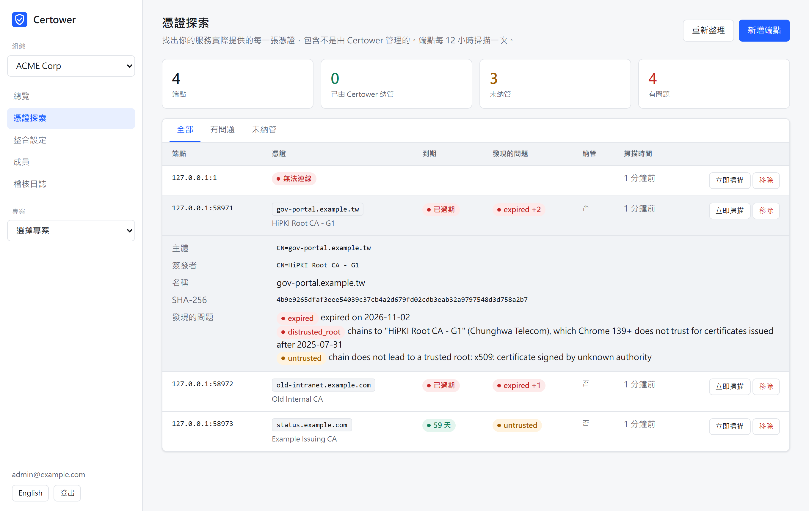

# Discovery and notifications



## Discovery

Discovery finds the certificates your services actually present, including
ones Certower did not issue, and flags problems before they cause outages.

Add endpoints under **Discovery** in the web UI, or with the API:

```sh
curl -X POST https://certower.example.com/api/v1/orgs/acme/discovery \
  -H "Authorization: Bearer $TOKEN" -H 'Content-Type: application/json' \
  -d '{"targets": "www.example.com\nmail.example.com:465\n10.0.0.12:8443", "project": "web"}'
```

Each line is `host` or `host:port` (port 443 by default). Endpoints are
scanned right away and then every 12 hours. A scan connects, records the
certificate chain, and checks it:

| Finding | Severity | Meaning |
|---|---|---|
| `expired`, `not_yet_valid` | critical | Outside its validity period |
| `expiring_soon` | warning | Fewer than 14 days left |
| `distrusted_root` | critical | Chains to a root browsers stopped trusting, such as Chunghwa Telecom's ePKI and HiPKI roots for certificates issued after 2025-07-31 (Chrome 139+) |
| `hostname_mismatch` | critical | Not valid for the name it was requested under |
| `untrusted` | warning | Chain does not lead to a publicly trusted root (normal for internal CAs) |
| `sha1_signature` | critical | Signed with SHA-1 |
| `weak_key` | warning | RSA below 2048 bits or ECDSA below 256 |
| `validity_too_long` | warning | Longer than the CA/Browser Forum allows for its issue date |

Certificates whose fingerprint matches a version Certower issued are shown
as **managed**; everything else is **unmanaged**, which usually means
someone installs it by hand.

Endpoints can be organization-wide or belong to a project; project members
see their project's endpoints, and alerts go to that project's notifiers.
Viewing needs `discovery.read`, adding and removing needs
`discovery.manage`.

**Scanning and your network.** The server connects to whatever endpoints
are added, so only give `discovery.manage` to people trusted to probe your
network. Link-local addresses, including the cloud metadata service
`169.254.169.254`, are refused unless the server runs with
`-discovery-allow-link-local`. Names are resolved once and the vetted
address is dialed, so DNS answers cannot redirect a scan.

## Notifications

Add a notifier under **Integrations → Notifications**, on the organization
(all projects) or on one project. Use **Send test** to check it.

### Webhook

```json
{"kind": "notifier", "plugin": "webhook", "name": "ops-slack",
 "config": {"url": "https://hooks.slack.com/services/...", "format": "slack", "minSeverity": "warning"}}
```

- `format: "json"` (default) posts the full event. With `secret` set, it adds
  `X-Certower-Timestamp` and `X-Certower-Signature: sha256=<hex>`, an
  HMAC-SHA256 over `timestamp + "." + body`. Verify it and reject old
  timestamps.
- `format: "slack"` posts `{"text": ...}`, which Slack, Mattermost and Google
  Chat accept. `format: "discord"` posts `{"content": ...}`.

The URL is stored encrypted, since chat webhook URLs are credentials.

### Email

```json
{"kind": "notifier", "plugin": "email", "name": "ops-email",
 "config": {"host": "smtp.example.com", "port": 587, "username": "certower",
            "password": "...", "from": "Certower <certower@example.com>",
            "to": ["ops@example.com"]}}
```

`security` is `starttls` (default), `tls` (implicit, port 465) or `none`.

### Events

| Event | When | Severity |
|---|---|---|
| `cert.issued` | A certificate was issued or renewed | info |
| `cert.issue_failed` | An attempt failed (once per request), or issuance stopped | warning / critical |
| `cert.expiring` | 21, 14, 7, 3 and 1 days before expiry, once each; and on expiry | info → critical |
| `cert.deploy_failed` | An agent could not install or verify a certificate | warning |
| `discovery.finding` | A scan found a critical problem (once per certificate and problem) | critical |

Every notifier can narrow what it receives with `events` (a list of event
types) and `minSeverity` (`info`, `warning`, `critical`). Failed deliveries
are retried with increasing delays, up to 8 attempts.

Set `-public-url https://certower.example.com` (or `CERTOWER_PUBLIC_URL`) so
notifications link to the right page.
